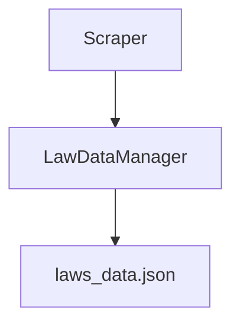

# Framework Workshop - 法規資料爬蟲系統

## 情境

作為一名 AI 工程師，你打算使用爬蟲技術，爬取法規資料，作為未來 AI 模型訓練的資料集。

你需要實作一個 `LawDataManager` 類別，用於集中管理法規資料，並透過 JSON 檔案儲存資料，作為後續模型或系統的輸入。

---

## System Architecture



---

## 題目

### 1️⃣ 實作 LawDataManager 類別

請建立 `law_data_manager.py`，實作 `LawDataManager` 類別，包含以下功能：

#### 屬性
- `json_file_path`: JSON 檔案路徑
- `laws_data`: 儲存法規資料的列表

#### 方法
- `__init__(json_file_path)`: 初始化，設定 JSON 檔案路徑
- `save_to_json()`: 將法律資料儲存到 JSON 檔案
- `load_from_json()`: 從 JSON 檔案載入資料
- `show_laws_data(limit)`: 顯示法律資料（預設顯示前 5 筆）

---

### 2️⃣ 實作爬蟲程式（Scraper）

請建立 `scraper.py`，實作法規爬蟲功能：

* 使用 Selenium 爬取 [勞動基準法](https://law.moj.gov.tw/LawClass/LawAll.aspx?pcode=N0060014)
* 爬取每個法條的：
  - 章節名稱
  - 條文編號
  - 條文連結
  - 條文內容
* 將資料儲存至 `LawDataManager` 實例中
* 將資料輸出為 `laws_data.json`

**提示：**
- 使用 Selenium headless Chrome 模式
- 使用 `WebDriverWait` 等待頁面載入
- 使用 `find_elements(By.CLASS_NAME, "row")` 找到所有法條列
- 注意章節與法條的區分

---

## 資料格式

### laws_data.json 格式範例

```json
[
  {
    "chapter": "第一章 總則",
    "article_number": "第 1 條",
    "article_link": "第一條",
    "content": "為規定勞動條件最低標準，保障勞工權益，加強勞雇關係，促進社會與經濟發展，特制定本法；本法未規定者，適用其他法律之規定。雇主與勞工所訂勞動條件，不得低於本法所定之最低標準。"
  },
  {
    "chapter": "第一章 總則",
    "article_number": "第 2 條",
    "article_link": "第二條",
    "content": "..."
  }
]
```

---

## 預期輸出

執行程式後，應該：

1. 爬取法規資料並儲存到 `LawDataManager` 實例
2. 將爬取的資料儲存為 `laws_data.json`
3. 在終端機顯示前 5 筆資料
4. 顯示總共爬取的法條數量

**終端機輸出範例：**
```
Starting web scraper...
Accessing website...
Page loaded successfully
Found 150 rows

New chapter: 第一章 總則
Processed: 第 1 條
Processed: 第 2 條
...

資料已儲存到 laws_data.json
總共儲存 86 筆資料

顯示前 5 筆資料：
============================================================

第 1 筆：
章節: 第一章 總則
條文編號: 第 1 條
條文連結: 第一條
內容: 為規定勞動條件最低標準，保障勞工權益...
------------------------------------------------------------

==================================================
Total articles scraped: 86

Chapters found:
- 第一章 總則
- 第二章 勞動契約
- 第三章 工資
...
```

---

## 執行方式

```bash
# 安裝相依套件
pip install selenium

# 執行爬蟲
python scraper.py
```

---

## 解答

完整的實作程式碼請參考：
- [Answer](https://github.com/4-learn/python-web-crawler/tree/master/selenium/workshop/framework)

---

## 學習目標

完成此練習後，你將學會：

1. ✅ 使用 Selenium 爬取動態網頁
2. ✅ 設計物件導向的資料管理類別
3. ✅ 使用 JSON 格式儲存與交換資料
4. ✅ 建立完整的資料處理流程（爬取 → 儲存 → 輸出）
5. ✅ 處理中文網頁資料的爬取與儲存
